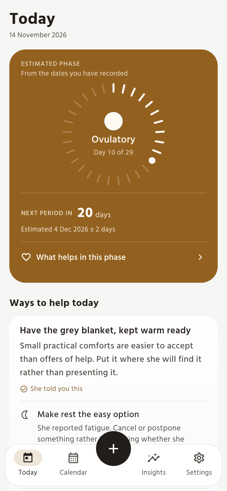
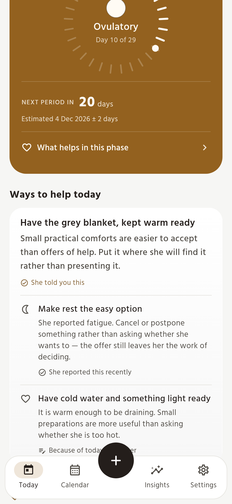
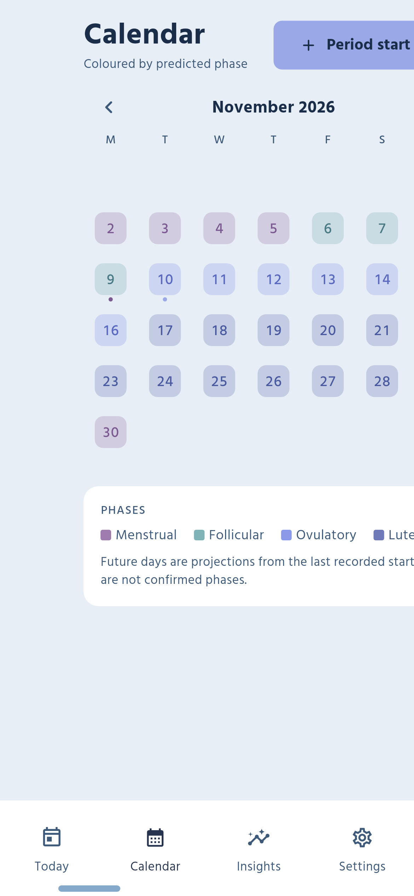
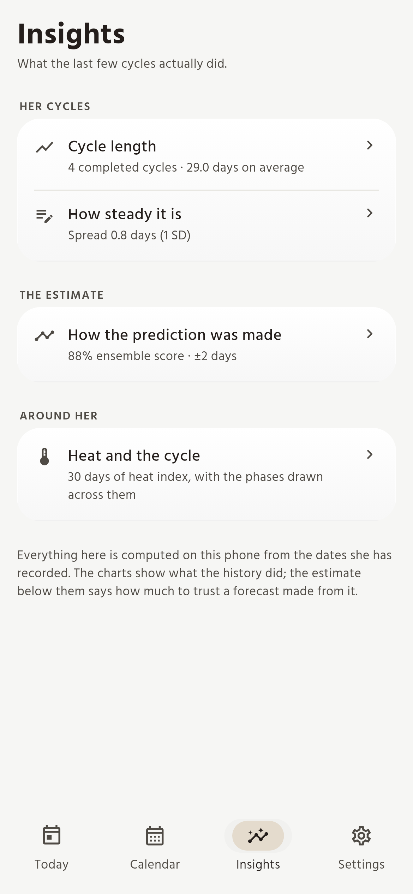
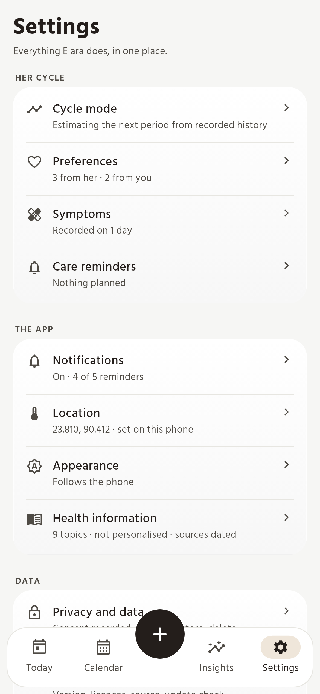
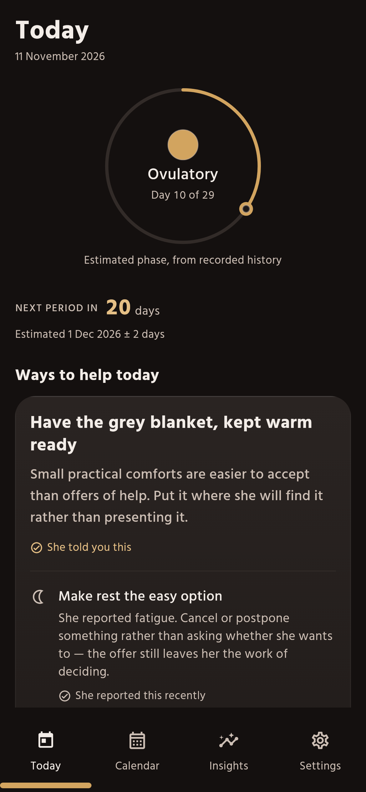
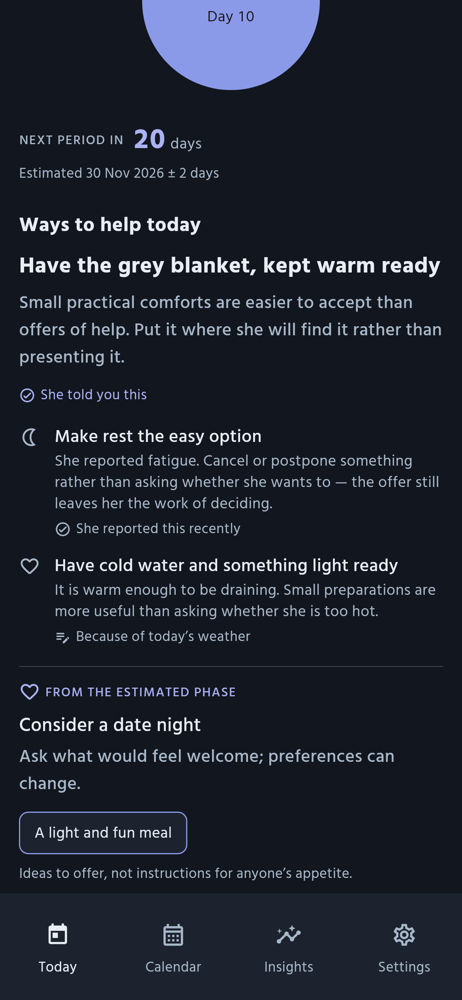
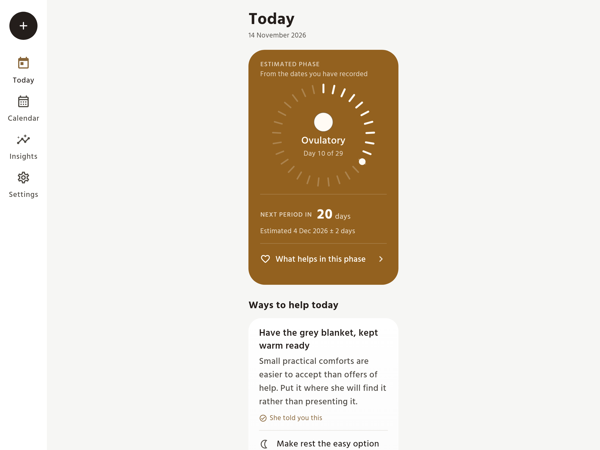

<p align="center">
  
</p>

<h1 align="center">Elara</h1>

<p align="center">An offline-first cycle companion for Android, with local ensemble forecasting and gentle daily guidance.</p>

<p align="center">
  <a href="https://github.com/mahimmazidul/elara-app/actions/workflows/ci.yml"></a>
  <a href="https://github.com/mahimmazidul/elara-app/actions/workflows/release.yml"></a>
  
  
  
  
</p>

<p align="center">
  <a href="https://mahimmazidul.github.io/elara-app/">Website</a>
  &nbsp;·&nbsp;
  <a href="https://github.com/mahimmazidul/elara-app/releases/latest">Download the APK</a>
</p>

Elara reads your cycle, the weather outside and the shape of the last few months,
then tells you what today looks like: which phase you are in, how many days remain
until the next period, and one concrete thing to do about it. Everything it knows
stays on the phone, in a local SQLite database, and computes there. Open the app
in Kuakata with the network off and every screen still works, because the
forecasting, the astronomy and the calendar conversion are all local code.

The prediction engine is [elara-core](https://github.com/mahimmazidul/elara-core),
an ensemble forecasting library consumed here as a git dependency. The app is the
part that turns its numbers into something a person can act on.

## Screenshots

| Today | Action cards | Calendar | Insights |
|:---:|:---:|:---:|:---:|
|  |  |  |  |

| Settings | Today, dark | Action cards, dark |
|:---:|:---:|:---:|
|  |  |  |

<p align="center">
  
  <br>
  <sub>Above 720dp the tab bar becomes a navigation rail and the content keeps a readable measure.</sub>
</p>

<p align="center">
  <sub>Every screenshot is a render of the real widget tree, regenerated and committed by the Screenshots workflow on any push that changes the app.</sub>
</p>

## What today looks like

The Today tab answers one question per visit. It opens with the current phase as a
coloured chip next to the cycle day, then a countdown to the next estimated period
with the confidence window spelled out, so a slightly irregular month reads as
honestly uncertain rather than falsely precise.

Below that sits the day's action card: movement, food and rest guidance drawn from
the phase and the environmental severity, phrased for the day you are having. A
heat index above forty overrides the gentle suggestions and tells you to sit still
and drink water, which is the correct advice in Khulna in May.

The lunar strip carries the moon phase, the nakshatra and the Hijri date. All
three are computed from the current date by the app itself.

## The calendar

The month grid is coloured by predicted phase, projected forward from your last
recorded start using the current forecasted cycle length, so future months show
real phases instead of one cycle of colour followed by blanks. Tapping any day
opens a sheet with the phase, the cycle day and the severity for that date.
Recording a period start is one button in the header.

## Insights

Three charts and a plain-language summary. Cycle lengths are plotted in order so a
lengthening trend is visible at a glance. The second chart shows the mean and the
sample standard deviation, which is the number that decides whether the prediction
is allowed to be tight or has to widen. The third plots the last thirty days of
heat index with phase bands behind it, which is the clearest way to see how a hot
week lands in your luteal phase.

With fewer than two completed cycles the charts say so directly rather than
drawing an empty axis.

## How the forecast is made

elara-core runs several estimators over your recorded starts and reconciles them
into one date with a confidence window. The window is derived from your own
variability: when consecutive cycles differ by less than a day and a half it stays
at one day either side, and beyond that it opens to two. Until three cycles exist
the engine keeps the window wide on purpose.

The forecast feeds the phase classifier, which works out where today falls inside
the current cycle, and the action engine, which converts that phase plus the
environmental severity into a suggestion. All of it is deterministic, so the same
history and the same day produce the same answer.

## Weather and air

Elara reads temperature, humidity, sunshine and PM2.5 for your coordinates from
Open-Meteo and Open-AQ, computes the Steadman heat index locally, and caches the
result for three hours. When a lookup fails it falls back to a seasonal baseline
built for Bangladesh, and labels the figure as an estimate in the interface so a
monsoon average is never mistaken for a measurement.

The severity modifier combines heat, air quality, hydration and sunshine into one
number that nudges the day's guidance up or down.

## Reminders

Five kinds of notification, each switched on and off separately in settings:

The morning briefing arrives at eight with the phase, the conversation score and
one food suggestion. A PMS warning begins the morning the late luteal phase starts,
once per cycle. The ovulation window opens on the first day of the ovulatory phase,
also once per cycle. A period reminder lands on the predicted first day. The
climate alert fires at two in the afternoon when the heat index passes forty.

Each reminder is scheduled individually and rebuilt whenever the app comes to the
foreground, so the text describes the cycle as it stands rather than as it stood
the day the schedule was created. The whole schedule is restored after a reboot.

## The app itself

Four tabs, a warm palette and one shadow. Every colour, text style and radius in
the app lives in `lib/theme/elara_theme.dart`, reachable from any widget through
`context.elara`, and the light and dark palettes are tuned so phase text clears
WCAG AA against its own background in both.

DM Sans ships with the app in three weights — 400 for secondary copy, 500 for
body, 700 for headings — so a first launch with no connection is fully typeset.
The bundled files are built by `tool/fonts/build_fonts.py`, which also adds a
`tnum` feature: upstream DM Sans has proportional digits and no tabular feature
at all, so the tabular figures the numeral styles ask for would otherwise do
nothing.

The accent follows the cycle phase. When a phase can be classified, the accent
becomes that phase's colour and the page and card surfaces take an eight per cent
tint of it, so the app quietly reflects where the cycle is without turning into a
colour wash. With no phase available it falls back to the neutral accent. Warning
and danger colours, and the four phase colours on the calendar, never change.

## How it is put together

```
lib/
  theme/elara_theme.dart      every colour, text style, radius and shadow
  data/                       sqflite schema, migrations, models
  services/                   climate, prediction, notifications
  models/elara_result.dart    the single aggregate the UI reads
  providers/                  cycle, prediction, climate, settings
  utils/                      moon phase, nakshatra, Hijri, phase timeline
  screens/                    today, calendar, insights, settings
  widgets/                    shared primitives
```

State is held in four providers over one shared database connection. The
prediction provider watches the cycle and settings revisions and recomputes when
either changes, so logging a period updates the calendar, the insights and the
reminder schedule without any screen knowing about the others.

Database access goes through a single helper with a versioned migration list and a
refusal to open a database written by a newer version of the app, which turns a
downgrade into a clear error instead of silent corruption.

## Running it

```
flutter pub get
flutter run
```

## Tests and analysis

```
flutter test
dart analyze --fatal-infos
```

The suite runs one hundred and forty tests. They cover the schema and every CRUD
path against a real SQLite engine, the climate service against mocked weather for
live, cached, malformed and offline cases, the prediction service across irregular
and out-of-order history, the moon phase against published new, full and quarter
moons, the nakshatra division, the four screens in their empty and populated
states, and the provider graph. Both commands pass clean, and CI runs them on
every push and pull request.

The screenshots above are generated by the Screenshots workflow, on every push
that can change what the app looks like, and committed back to main when they
differ. Nothing about them depends on the machine they were made on, and no one
has to remember to regenerate them by hand. Running
`flutter test tool/screenshots/screenshots_test.dart` locally produces the same
files if you want to look before pushing.

## Releases

The version in `pubspec.yaml` is the version of record. Bump it and push to main,
and the release workflow tags that exact commit, runs analysis and the test suite,
builds a signed app bundle and signed APKs, publishes them on a GitHub release with
notes generated from the commits since the previous tag, and updates the
[landing page](https://mahimmazidul.github.io/elara-app/) with the new version and
download link. Pushing a `vX.Y.Z` tag by hand does the same thing for that tag, and
the workflow can be started from the Actions tab when a version needs re-cutting.
A push that leaves `pubspec.yaml` alone never releases anything.

Every release carries one APK per CPU architecture, so a phone downloads only the
native libraries it can actually run:

```
elara-1.0.3-arm64-v8a.apk      most phones since around 2018
elara-1.0.3-armeabi-v7a.apk    older 32-bit devices
elara-1.0.3-x86_64.apk         emulators and x86 tablets
elara-1.0.3-universal.apk      everything in one file, for anything else
elara-1.0.3.aab                the Play Store bundle
```

The landing page button offers the arm64 build and links the universal one next
to it on small print.

The launcher icon is generated from `tool/icon/generate_icon.py` into the mipmap
folders, including the adaptive and themed variants, so the mark can be changed in
one place and regenerated.

## Licence

GNU Affero General Public License v3.0. The full text is in [LICENSE](LICENSE).
