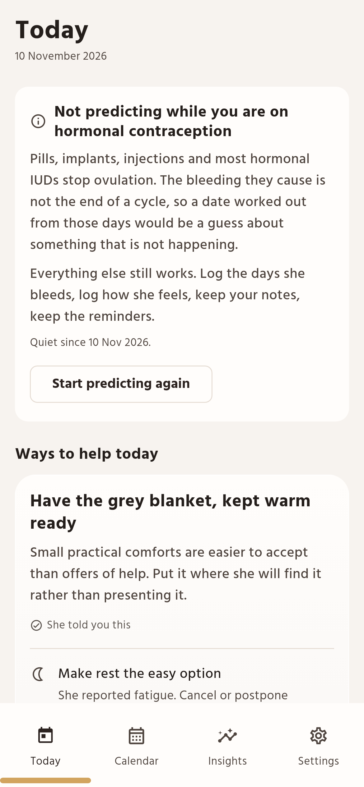
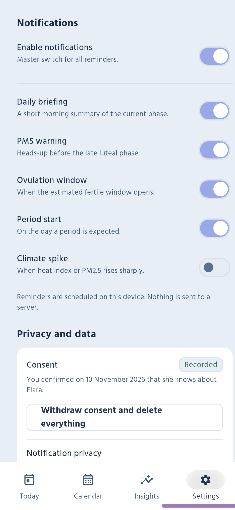
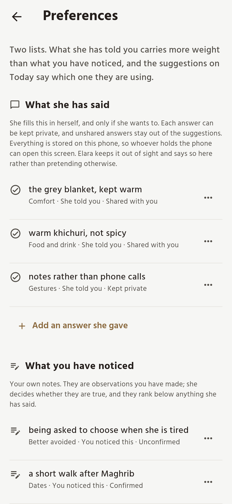
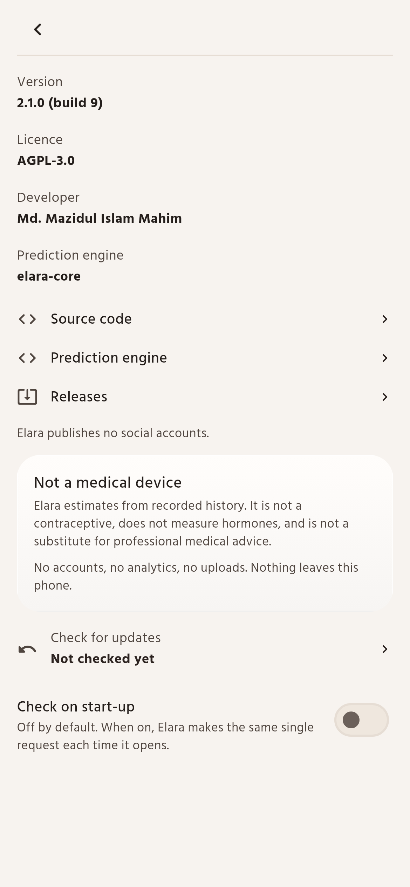

<div align="center">


# Elara

**A quiet Android companion for understanding a menstrual cycle and for caring
about the person living it.**

Elara keeps a cycle history on one phone, shows where the cycle probably is and
how uncertain that estimate is, and turns the answer into a few concrete things a
partner can do today: something to cook, something to prepare, a question worth
asking. 

[](#installation)
[](https://flutter.dev)
[](LICENSE)
[](https://github.com/mahimmazidul/elara-app/releases/latest)
[](https://github.com/mahimmazidul/elara-app/actions/workflows/ci.yml)
[](https://github.com/mahimmazidul/elara-app/actions/workflows/release.yml)

[**Download**](https://github.com/mahimmazidul/elara-app/releases/latest) ·
[**Screenshots**](#a-closer-look) ·
[**Features**](#what-it-does) ·
[**Privacy**](#privacy-you-can-point-at) ·
[**Documentation**](docs/FEATURE_REGRESSION.md) ·
[**Source**](https://github.com/mahimmazidul/elara-app)

<sub>Website: [mahimmazidul.github.io/elara-app](https://mahimmazidul.github.io/elara-app/)</sub>

</div>

---

## Why it exists

A calendar can tell you roughly where a cycle is. It cannot tell you how someone
feels, what she wants for dinner, or whether she would rather have company or
quiet tonight. 

Elara is built on the opposite bet. It states what it actually knows (dates it was
given), shows how sure it is (a stated window, not a single confident day), and
turns everything else into a prompt to ask. The most useful thing on the home
screen is not the countdown. It is the line underneath a suggestion that says
*"she told you this"* — because that is the difference between care and
guessing.


## A closer look

<sub>Real renders of the running app over a fixed fictional dataset, produced by
`tool/screenshots/screenshots_test.dart` — no mockups, no retouching. One column,
images capped at 260 px, so this page survives a 360 px phone. Full-size originals
and the [contact sheet](docs/screenshots/contact-sheet.png) are in
[`docs/screenshots/`](docs/screenshots); viewports and method in
[`docs/SCREENSHOT_MANIFEST.md`](docs/SCREENSHOT_MANIFEST.md).</sub>

### Today, at a glance

<p align="center">

</p>

Everything the day needs, in the order it is useful:

- **Where the cycle is** — a phase chip with the cycle day, clearly labelled as
  an estimate.
- **When the next period is due** — days remaining plus the date and its window
  (`± 2 days`), never a bare confident number.
- **What to actually do** — one primary suggestion with the rest of the day's
  ideas beneath it.
- **Where each idea came from** — *she told you this*, *she reported this
  recently*, *from your notes*, *because of today's weather*, *from the estimated
  phase*. Known information and inference never look alike.

### When a prediction is not the answer

<p align="center">

</p>

A calendar estimate assumes there is a cycle to estimate. On hormonal
contraception there is not one — bleeding is withdrawal or breakthrough — so a
countdown built from those days would be a confident description of something
that is not happening. Around six in ten married women in Bangladesh use a
modern method, and oral pills are the most common one, so this is the ordinary
case for this app, not an edge case. The same applies to a pregnancy, a loss,
and the months after a birth, where the app used to keep counting and then say
the period was late.

- **Three modes**, chosen in Settings and reversible from the screen that says
  the app is quiet: estimate the cycle; she uses hormonal contraception; paused.
- **The claims go, the care stays.** No phase, no countdown, no window, no
  fertile estimate, and every reminder that depends on them stops being
  scheduled. Her bleeding log, symptoms, your notes, the reminders you wrote,
  the weather and the suggestions all remain — and the screen says the
  suggestions come from what she has told you rather than from a phase it cannot
  see.
- **Nothing is deleted**, and nothing is assumed: an unreadable stored setting
  fails quiet rather than inventing a cycle.

### Suggestions that say why

<p align="center">

</p>

One primary idea, then a ladder of evidence: what she said she likes, what she
reported feeling, what you noticed, what the weather is doing, and last what the
calendar implies. Practical rather than poetic — at 38 °C it suggests staying
indoors instead of proposing a walk, and on a bad air day it says why. Symptoms
soften suggestions; nothing has to be logged, and a day with no records is a
normal day.

Underneath that, and instead of it on a first launch, sits **general guidance for
the phase**: heat before painkillers for cramps (NICE), iron-rich food in the
shape of lentils and small fish rather than supplements on assumption (WHO),
protein at the first meal because a plate of rice alone will not hold a morning
(BIRDEM), and the note that mild one-sided mid-cycle pain is common and severe
pain is not. Every item names where it came from. None of it is personalised, so
none of it can be wrong about her — and the screen says which paragraph is which.

Settings and the pages behind it now use a **glass surface**: translucent panes
with a lit rim and no outline, grouped so one subject is one object. Deliberately
not a `BackdropFilter` — the blur costs a save-layer on every scroll frame, and
the phones most of this app is read on notice.

### A calendar that admits what it is

<p align="center">

</p>

Four phase colours, used everywhere. A day she logged is drawn differently from a
day arithmetic put there, and the note under the grid says so. Tapping a day opens
its own suggestion, computed for that date. A recorded start can be moved or
removed behind a confirmation, and every dependent screen updates with it.

### Insights without false confidence

<p align="center">

</p>

Cycle-length history oldest to most recent, so a trend is visible rather than
inferred; an average with a real standard deviation and its sample size
(`29.0 days ± 0.8 (1 SD, n = 4)`), because four cycles are not forty. The screen
says a steady cycle will be predicted closely and an erratic one will not,
instead of the same reassuring sentence either way.

### Privacy you can point at

<p align="center">

</p>

- **Offline by default** — with the radio off, history, prediction, astronomy and
  suggestions all still work. There is no server to hold anyone's history.
- **Consent, recorded and reversible** — a gate before first use, a timestamped
  record, and one control that withdraws consent and deletes everything.
- **Private reminders, encrypted backup** — notifications carry no cycle wording
  unless you opt in and stay off the lock screen either way; export is AES-256-GCM
  under your passphrase (PBKDF2, 210 000 iterations).

### Structured, honestly

<p align="center">

</p>

Two perspectives, kept separate. **What she has said** — an optional
questionnaire she fills in herself, each answer shareable or kept private; only
shared answers reach the suggestions. **What you have noticed** — your notes,
labelled as observations, promoted to facts only when she confirms them. Nothing
is scored: no romance, mood or emotional-availability numbers, because none of
those is a quantity. The screen states plainly that the phone's owner can read
anything stored, because an app without accounts cannot promise otherwise.

### Settings, without the boxes

<p align="center">

</p>

<p align="center">

</p>

Settings used to be five cards; it is now four headed sections — Location,
Preferences, Health information, Appearance — and About is plain label-and-value
rows. Nothing was removed to achieve that. Rows are measured before they are
placed, so a long value wraps under its label instead of overflowing, and the
update switch is a custom shape rather than a stock `SwitchListTile`, which
overflowed its row by 60 px at a 2× font scale.

## Light and dark

<p align="center">

</p>

<sub align="center">**Dark** — `#1A1A1A` page, `#242424` card. Light is the first capture above: `#FAFAF8` page, `#FFFFFF` raised surface.</sub>

Surfaces are deliberately neutral and the phase colour is an accent — a chip, a
border, a numeral, a tint where it earns one. Tinting every card by phase made the
app read as a dashboard and pushed contrast down; the palette now clears WCAG AA in
all eight theme × phase combinations, asserted in `test/theme/phase_theme_test.dart`.

Type is **Hind Siliguri** at four weights — Bengali-first, with a well-drawn Latin —
so one family draws both scripts, with a real `tnum` feature
(`tool/fonts/build_hind_siliguri.py`) so values that update in place do not shift
sideways. Settings, About and the consent gate are sections and plain text, not
cards on cards.

## What it does

Everything below is in the released app. Nothing here is a preview.

**Cycle awareness** — log a period start and its duration, correct or remove a past
one; phases (menstrual, follicular, ovulatory, luteal) in one colour each, used
everywhere; next-period estimate with a stated window, days remaining and cycle day.
Prediction is **three-mode and switchable**: estimate the cycle, *she uses hormonal
contraception* (pills, implant, injection, hormonal IUD — no ovulatory cycle to
estimate, and a countdown would describe something that is not happening), or
paused, for a pregnancy, a loss, after a birth, or because she would rather not be
given a date. In those modes phase, countdown, window and fertile estimate leave
Today, the calendar and the reminder schedule; everything else stays, and nothing
is deleted. Under the date the app also annotates her **own history**: when a wide
window means the range *is* the estimate, and when the last interval was about twice
her usual one — usually a period that went unrecorded, not a cycle that changed.

**Care, in words** — a phase-appropriate prompt from the engine's rule table
(*"Offer practical support"*, *"Check in gently"*, *"Consider a date night"*) with a
standing caveat; food ideas as chips, offered not instructed; suggestions ranked by
evidence — her shared answers, then reported symptoms, then your observations, then
the weather, then a general idea that claims nothing. Optional symptoms (cramps,
headache, fatigue, bloating, nausea, breast tenderness, mood, bleeding intensity)
soften suggestions and never diagnose.

**Notes and plans** — a symptom log that appears on Today and on the calendar and
can be corrected; care reminders (supplies before they run out, an errand, an
evening she would enjoy) with a done tick; preferences in two perspectives, a
questionnaire she fills in herself with each answer shareable or kept private, and
your observations, which stay labelled as observations until she confirms them.

**Environment and sky** — heat index, PM2.5 and the Bangladesh season for your
location, cached for offline use with a seasonal fallback marked *estimated*; moon
phase, nakshatra and Hijri date computed on the device, astronomical phase kept
separate from official Hijri.

**Reminders** — daily briefing, PMS warning, fertile-window notice, expected
period, heat or air-quality spikes, each individually switchable, all private by
default.

**Health information** — a separate general section (period pain, heavy or
prolonged bleeding, irregular periods, PMS, PMDD, PCOS, endometriosis, OTC pain
relief) from published sources with the date they were checked, kept strictly
apart from the personalized care on Today.

**Data** — encrypted export and restore, one control that withdraws consent and
deletes everything, and an opt-in update check against GitHub Releases that sends
nothing about you and never installs anything itself.

## Prediction methodology

Cycle dates are the only input.

Three independent estimators run against the same history — one from recent
lengths with an explicit statistical model, one weighting recent cycles more
heavily, one conservative about short histories — each reporting its own
confidence. The outputs are fused into a confidence-weighted consensus, not
averaged. Two rules keep that honest: **an observed start beats a forecast** (a
recorded period is a fact, and no estimator's opinion outvotes it), and **no
engine may contradict itself** (each must return a date and cycle length that
agree; the fusion layer throws if one does not).

The window beside the estimate comes from the observed variability of her own
history, widened when few cycles exist or the cycle is irregular. It is a range,
never a guarantee, and the project does not claim a coverage figure it has not
validated. When a period is overdue the classifier refuses to wrap silently into
the next cycle: a prediction that quietly restarts is worse than one that admits
it is stale.

**No machine learning, on purpose.** A learned model would need data to leave the
device, or a training set that does not exist for one person's history. The
statistical approach is measurable and explainable, and it lives in
[**elara-core**](https://github.com/mahimmazidul/elara-core) so it can be tested
apart from the UI.

## Medical boundaries

Elara is **not a medical device and not a contraceptive**. It cannot confirm
ovulation, diagnose a condition, or tell anyone whether a symptom is serious.

- Phases are **calendar arithmetic**, not measurements. No hormone is measured.
- Predictions get worse with irregular cycles and are weak with one or two
  recorded starts — the app says so rather than smoothing it over.
- Symptom logging is a personal record, not an assessment; no medication advice is
  generated from a phase or a severity.
- No condition — PCOS, PMDD, endometriosis, dysmenorrhoea — is diagnosed or
  inferred from calendar data.
- Unusual bleeding, severe pain, or a cycle that changes suddenly are reasons to
  see a clinician, not to consult an app.
- The **Health information** section is general education with sources listed and
  dated. It is not clinical advice, has not been clinically reviewed, and is not
  selected from cycle data.
- Measured behaviour, including where it falls short, is in
  [`docs/PREDICTION.md`](docs/PREDICTION.md).

## Installation

**Android 7.0 (API 24) or newer.** Android only: no iOS, web or desktop build.

Download from the [latest release](https://github.com/mahimmazidul/elara-app/releases/latest):
**`arm64-v8a`** for almost every phone made since 2015 (recommended),
`armeabi-v7a` for older 32-bit devices, `x86_64` for emulators, and `universal`
if unsure. The `.aab` is for store distribution.

Releases are signed, and the release workflow verifies the signature by parsing
the APK before publishing. Permissions are limited to notifications, exact alarms
so reminders are punctual, and boot-completed so the schedule survives a restart.
Location is typed in, never read from the device.

## Development setup

Flutter with Dart 3.10 or newer (CI uses the 3.47 stable line), plus an Android SDK
to run on a device or emulator. The test suite needs no Android SDK.

```bash
git clone https://github.com/mahimmazidul/elara-app.git
cd elara-app
flutter pub get
flutter test                  # the whole suite on the Dart VM
flutter run                   # needs a connected device or emulator
```

`elara-core` is a git dependency pinned by ref in `pubspec.yaml`, so `pub get`
resolves it with no extra setup.

## Architecture

```
lib/
  main.dart              provider graph, theme wiring, the consent gate
  data/                  SQLite schema (v4), migrations, models
  providers/             ChangeNotifier state: cycles, prediction, settings,
                         consent, preferences, symptoms
  screens/               one directory per tab, plus consent and preferences
  services/              prediction, care recommender, climate, notifications, backup
  theme/                 every colour, type style and spacing value
  utils/                 phase timeline, moon phase, nakshatra, Hijri date
  widgets/               shared primitives and the icon set
```

Three decisions shape most of the code. **One provider graph**, wired in
`main.dart` and ordered by dependency: nothing constructs its own database
connection, a mutation bumps a revision counter, and dependents recompute — so
there is exactly one path from "she logged a date" to the calendar, the theme and
the reminder schedule being current. **All colour** lives in
`lib/theme/elara_theme.dart`; no widget hardcodes one, and every ink is
contrast-checked against the surface it sits on. **Only the storage layer speaks
SQL** — `DatabaseHelper` owns the schema, migrations and queries, each migration
upgrades exactly one version, and a downgrade throws rather than letting an older
build read a newer file.

Dependencies are `elara_core` (prediction, phases, the action engine),
`provider`, `sqflite`, `flutter_local_notifications` +
`android_alarm_manager_plus` + `timezone` for reminders that survive a reboot,
`fl_chart`, `http` for weather and air quality only, `intl` + `hijri`,
`cryptography` for AES-GCM and PBKDF2, and `share_plus`.

## Testing and CI

```bash
dart analyze --fatal-infos    # must be clean
flutter test                  # the whole suite
```

Suites are grouped by layer: `data/` for schema, migrations and every CRUD path
against real SQLite; `providers/` for the state machines including consent;
`services/` for prediction, climate, backups, notification privacy and the care
recommender; `screens/` and `widgets/` at several sizes and text scales; `theme/`
for contrast in every phase of both palettes. The screenshots in this README are
generated by a test too (`tool/screenshots/screenshots_test.dart`), so they come
from the build rather than from a picture of an intention.

Two things that cannot be checked by running the app are written down instead:
[`docs/PREDICTION.md`](docs/PREDICTION.md) for what the uncertainty window actually
covers and where it falls short, and
[`docs/PRIVACY_MODEL.md`](docs/PRIVACY_MODEL.md) for what is stored, what protects
it, and what is deliberately not claimed. CI runs analysis and the suite on every
push; the release workflow builds per-ABI APKs plus an AAB, verifies the signature,
and publishes a GitHub release. The version shown in Settings is checked against
`pubspec.yaml` by a test, after it once drifted.

## Roadmap

Done in 1.3.0: prediction modes for hormonal contraception, pregnancy, loss and
after a birth; history notes under the estimate; the dispersed-error fix in
`elara-core`; the privacy correction above; `targetSdk` 36 for Play.

Next, in order:

1. **Bangla.** The app bundles a Bengali-first typeface and ships English only.
   That is the largest remaining gap for the audience this is written for.
2. **A latent-state model of the cycle with the logging process in it**, so a
   skipped month stops being scored as a sixty-day cycle and the interval can go
   asymmetric. The app now *labels* that case; this fixes it.
3. **An ablation of the ensemble.** It beats its best single engine by 0.1 days,
   inside its own bootstrap interval. If it cannot clear that on held-out
   participants, ship the simpler core and keep the ensemble behind a flag.
4. **The inputs the engine already understands and no screen collects**: spotting
   as a non-start observation, LH strips, cervical mucus, basal body temperature.
5. **A prospective cohort in the population this is built for**, and a model
   card. The current evaluation is a 1990s North American fertility-care sample;
   it is methodologically careful and demographically irrelevant here.

## The name

Elara is a mortal woman in Greek myth — daughter of Orchomenus, mother of the giant
Tityos by Zeus — who carried her child hidden beneath the earth. That is the whole
of the classical material, and it says nothing about the moon, fertility or the
body; she is not a lunar goddess in any ancient source, though a moon of Jupiter
carries her name. The name here is a modern, open reading of one thing the two
share: something carried quietly, for a long time, by someone else. The moon in the
interface is a motif for that rhythm, not a claim about the myth.

## Credits

**Developed by [Md. Mazidul Islam Mahim](https://github.com/mahimmazidul)** —
design, implementation and the [elara-core](https://github.com/mahimmazidul/elara-core)
prediction engine.

- **Source:** <https://github.com/mahimmazidul/elara-app>
- **Website:** <https://mahimmazidul.github.io/elara-app/>
- **Issues:** <https://github.com/mahimmazidul/elara-app/issues>
- **Prediction engine:** <https://github.com/mahimmazidul/elara-core>

No other social profiles are listed here because none have been verified — this
README will not invent one.

**Acknowledgements.** Flutter and Material Design;
[Hind Siliguri](https://fonts.google.com/specimen/Hind+Siliguri) by the
Indian Type Foundry, under the SIL Open Font License 1.1 (the licence text
ships with the app in `assets/fonts/OFL.txt`);
[Open-Meteo](https://open-meteo.com) for weather and
[OpenAQ](https://openaq.org) for air quality, both free and keyless; the
[`hijri`](https://pub.dev/packages/hijri) package for the Umm al-Qura calendar.

## Contributing

Issues and pull requests are welcome at
[github.com/mahimmazidul/elara-app](https://github.com/mahimmazidul/elara-app).

Before opening a pull request, run `dart analyze --fatal-infos` and
`flutter test`, and add a test for anything touching data, privacy or the
prediction. Conventions worth knowing:

- No colour outside `lib/theme/elara_theme.dart`.
- No new dependency without a stated reason.
- **No numerical scores describing a person**, anywhere in the UI, notifications
  or exports — and no wording that implies a phase determines mood, affection,
  interest or consent.
- No feature that could be used to monitor someone's cycle without their
  knowledge.
- Medical content must be reviewer-editable data with a source URL and a review
  date, not prose baked into a widget; and no medical claim ships without clinical
  review.

## License

Elara is released under the [GNU Affero General Public License v3.0](LICENSE). You
may use, study, modify and distribute it; if you run a modified version as a
network service, you must offer its source under the same terms.

<div align="center">
<sub>Made for someone specific. If it helps you notice something you would have
missed, it has done its job.</sub>
</div>
